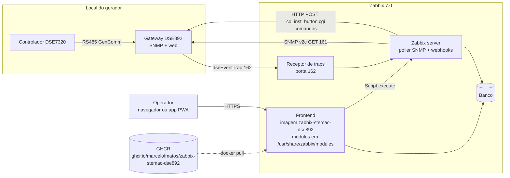
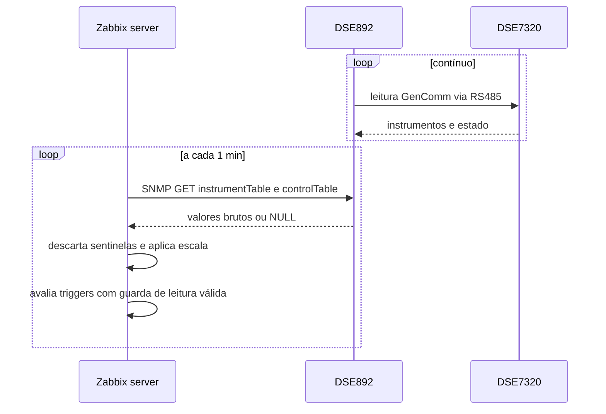
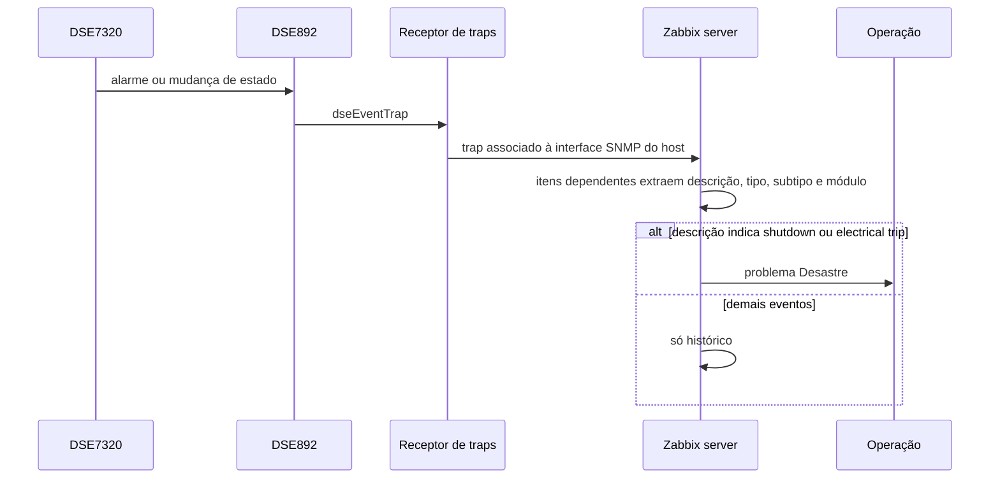
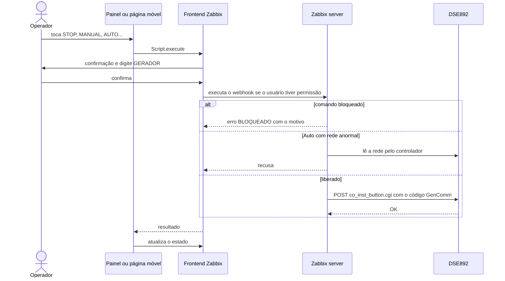
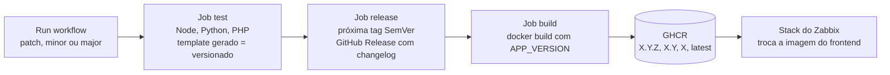

# Arquitetura e fluxos

## Arquitetura

| Peça | Onde está | Papel |
|---|---|---|
| Template | `zabbix/template_dse892_gerador.yaml` | itens SNMP, traps, triggers, gráficos, dashboard |
| Scripts Webhook | criados por `zabbix/criar_comandos.py` | comandos ao controlador pela web do DSE892 |
| `painel-gerador` | widget | lê itens, problemas e scripts permitidos do host e desenha o painel |
| `gerador-movel` | página `gerador.movel` | mesmos dados do painel, layout de celular; reusa `painel-estado.js` |
| `pwa-zabbix` | módulo comum | manifest e metas de app em todas as páginas |
| `atalhos` | widget | links para dashboards |
| Imagem | `Dockerfile` | frontend oficial + os quatro módulos; entrypoint loga a versão e chama o oficial |
| CI/CD | `.github/workflows/release-and-build.yml` | testes, tag SemVer, release e push da imagem no GHCR |

## Fluxo 1 — Coleta

## Fluxo 2 — Eventos por trap

## Fluxo 3 — Comando pelo painel

## Fluxo 4 — Release e build da imagem

